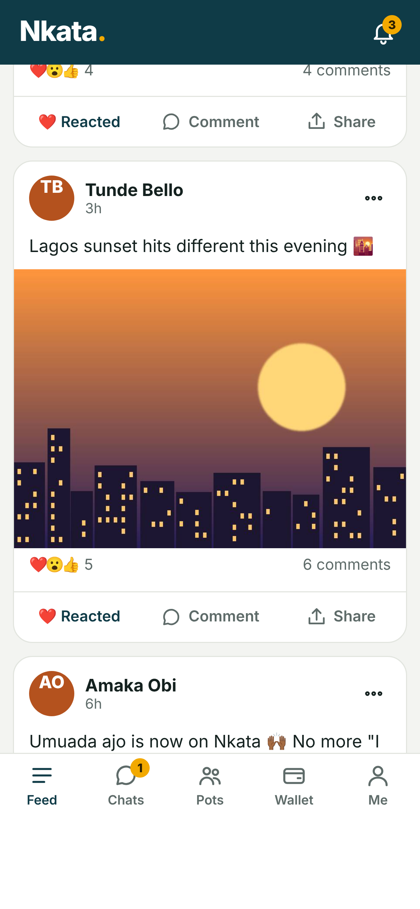
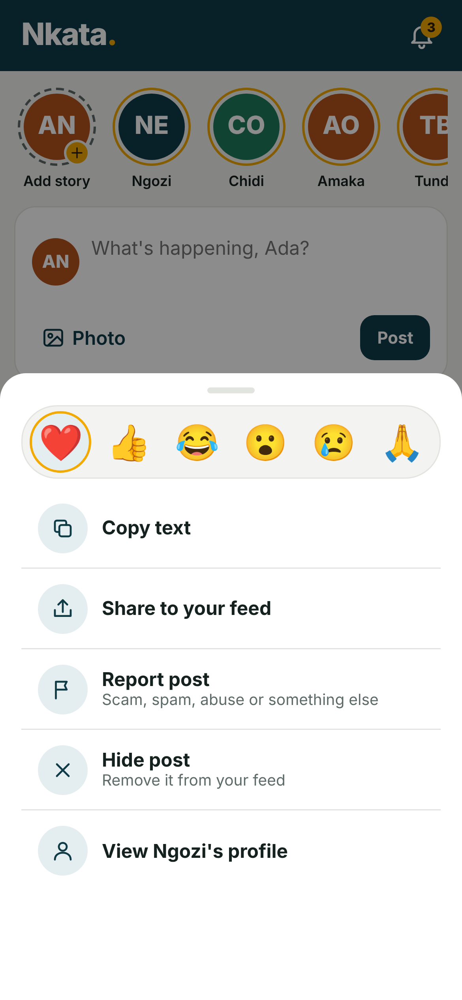
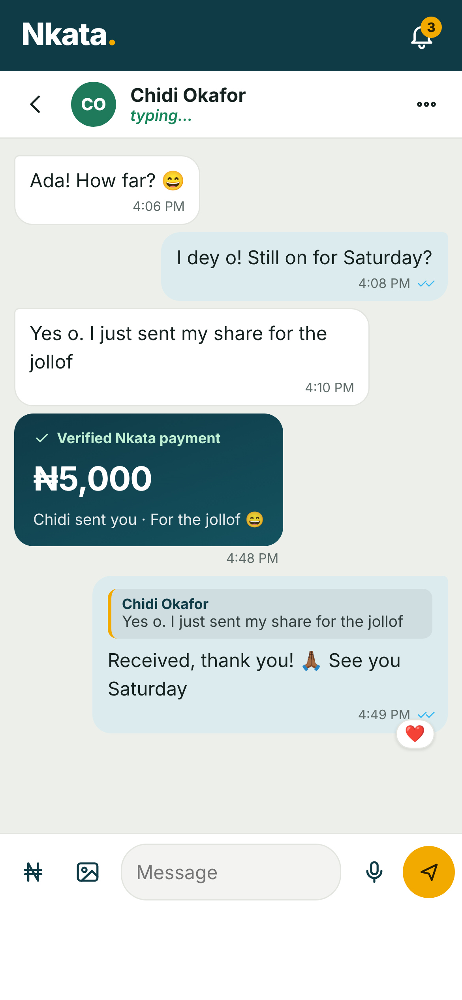
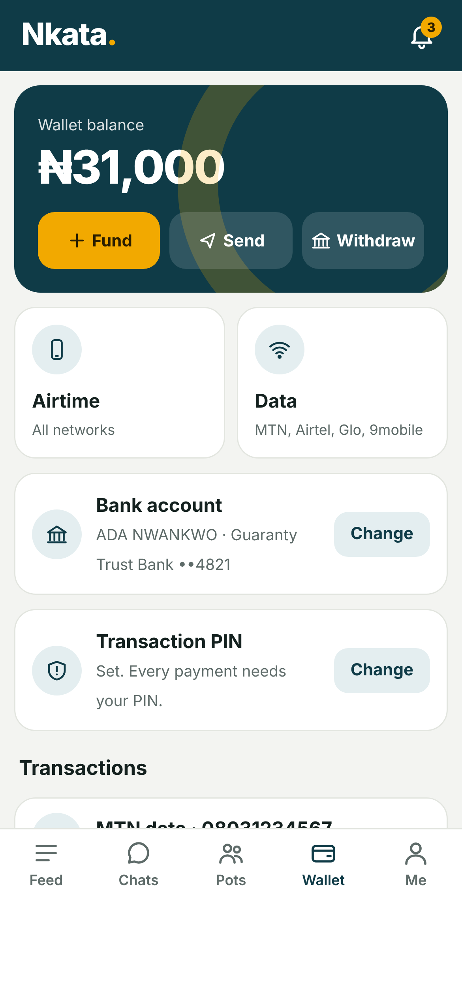
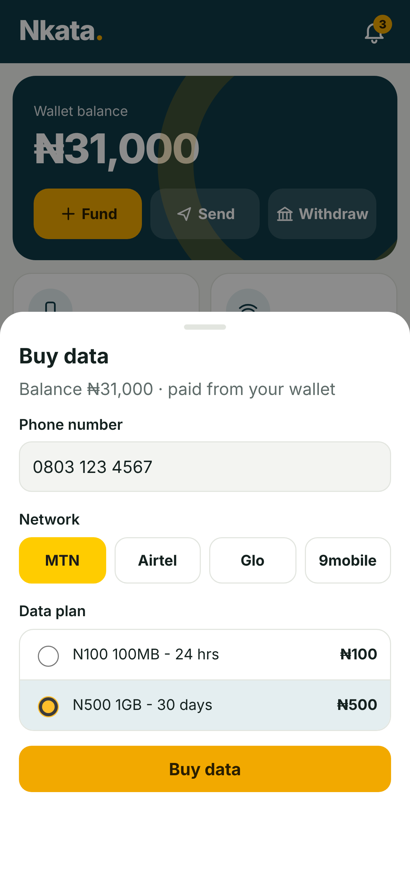
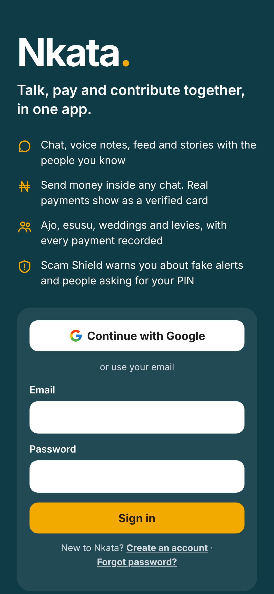

## Nkata: social and payments app for Africans
**Live demo:** https://nkata-app.netlify.app  
**Status:** Working beta. Payments run on Paystack and VTpass test mode.

Nkata ("conversation" in Igbo) combines chat, a social feed and a wallet in one installable web app, so people can talk, pay and contribute with the same circle they trust.

### Features
- **Chat:** one-to-one and group chats with photos, voice notes, replies, reactions, typing indicator and read ticks
- **Social:** feed, stories, threaded comments, reactions and sharing; press and hold for quick actions
- **Wallet:** fund with Paystack, send money inside any chat, withdraw to Nigerian banks
- **Airtime and data:** MTN, Airtel, Glo and 9mobile through VTpass, with automatic refunds on failure
- **Contribution pots:** ajo, esusu and levies, with every payment recorded
- **Scam Shield** and an **admin dashboard** for reports and account suspensions

### Tech stack
Vanilla JavaScript PWA · Firebase Auth, Firestore and Cloud Messaging · Netlify Functions (Node.js) · Paystack API and webhooks · VTpass API

### Engineering highlights
- Money moves only on the server; Firestore security rules stop clients from editing balances
- Each payment is credited once only, and webhook signatures are checked with HMAC-SHA512
- Transaction PINs hashed with scrypt, with lockout after repeated wrong attempts
- Failed transfers and bill payments refunded exactly once
